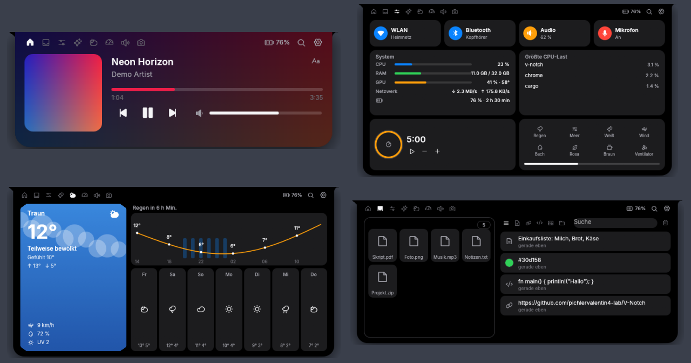

# V-Notch (Rust)

A desktop "notch" that sits at the top of the screen and shows what is going on: the song that is playing,
volume, clipboard, weather, timers, Claude Code sessions and a Spotlight-style launcher.

This is a Rust port of [V-Notch](https://github.com/DavidLeitnerHTL/V-Notch) (C#, WPF, Windows only).
The port runs on **Windows** and adds a **Linux** version; a macOS backend is included but less tested.
Every push is built and tested on all three systems by GitHub Actions, and the Linux build is started
under a virtual X server to check that the window really comes up.



## Features

| Area | What it does |
| --- | --- |
| Media | Cover art, title and artist, seek bar, play/pause/skip, synced lyrics, clock and calendar when nothing plays |
| Shelf | Drop files on the notch to keep them, clipboard history with search, links, colours and code |
| Controls | Wi-Fi, Bluetooth, audio and microphone toggles, CPU/RAM/GPU/network, timer, ambient sounds |
| Claude | Live Claude Code sessions through a local hook endpoint, allow or deny permission prompts from the notch |
| Weather | Current weather, hourly curve and 7-day forecast from Open-Meteo |
| Mixer | Per-app volume, output and input device switch |
| Legion | Power mode and key toggles on Lenovo Legion laptops (Windows) |
| Spotlight | `Alt+Space`: apps, files, calculator, system commands and an AI chat (Claude, OpenAI, Gemini, DeepSeek or a local Ollama) |
| Translation | Hotkey translates the selected text |
| Settings | 17 languages, size, shape, animations, behaviour, tabs, devices, privacy, updates |

## Platform support

| Feature | Windows | Linux | macOS |
| --- | --- | --- | --- |
| Media info and control | GlobalSystemMediaTransportControls | MPRIS over D-Bus | AppleScript (Music, Spotify) |
| Volume, mixer, devices | Core Audio | `pactl` (PulseAudio and PipeWire) | CoreAudio |
| Wi-Fi, Bluetooth | WinRT radios | `nmcli`, `bluetoothctl` | `networksetup`, `blueutil` |
| Window placement, click-through | Win32 | X11 (XWayland is preferred on Wayland) | AppKit |
| Tray icon | yes | StatusNotifierItem (`ksni`) | yes |
| Secrets (API keys) | DPAPI | `secret-tool`, else a private file | Keychain |
| Autostart | Registry | `~/.config/autostart` | LaunchAgent |
| Legion controls | yes | no | no |

## Build

You need a current stable Rust (1.89 or newer).

### Windows

```powershell
cargo build --release
.\target\release\v-notch.exe
```

### Linux

Debian and Ubuntu packages for the default features (audio through ALSA, TLS through OpenSSL):

```bash
sudo apt install build-essential pkg-config libasound2-dev libssl-dev \
    libxkbcommon-x11-0 libxcursor1 libxrandr2 libxi6 libgl1
cargo build --release
./target/release/v-notch
```

Command line tools the Linux version calls when they are installed: `pactl` (volume and mixer),
`nmcli` (Wi-Fi), `bluetoothctl` (Bluetooth), `secret-tool` (API keys in the keyring),
`systemctl` and `loginctl` (lock, sleep, restart from Spotlight).
Without ALSA headers, build with `cargo build --release --no-default-features --features tls` (no sounds).

On Wayland the app starts through XWayland when it is available, because Wayland does not let a window
place itself or stay on top.

To add it to the application menu for the current user:

```bash
install -Dm755 target/release/v-notch ~/.local/bin/v-notch
install -Dm644 assets/logo.png ~/.local/share/icons/hicolor/256x256/apps/v-notch.png
install -Dm644 packaging/linux/v-notch.desktop ~/.local/share/applications/v-notch.desktop
```

### macOS

```bash
cargo build --release
./target/release/v-notch
```

## Command line

| Option | Meaning |
| --- | --- |
| `--demo` | Sample data, a temporary settings folder, no tray and no hotkeys |
| `--view <Tab>` | Open a tab: `Media`, `Secondary` (shelf), `Timer` (controls), `Claude`, `Weather`, `Legion`, `AudioMixer`, `Camera` |
| `--spotlight`, `--spotlight-ai`, `--query <text>` | Open Spotlight, optionally in AI mode or with a search |
| `--settings <section>` | Open the settings window |
| `--language <code>` | Override the language, for example `de` |
| `--screenshot <file.png>` | Save a picture of the window after 2.5 s and quit |
| `--exit-after <seconds>` | Quit after the given time |
| `--stats` | With `--exit-after`: print frames per second, why each frame was drawn and animation smoothness |
| `--click <x,y@seconds>` | Click at a point of the window at that time, without moving the real mouse (repeatable) |
| `--profile <folder>` | Run a second, real instance with its own settings, next to the one already running |

Example: `v-notch --demo --language de --view Weather --screenshot weather.png`

## Project layout

```
src/
  main.rs, app.rs      start-up, command line, windows, tray and hotkeys
  notch/               the notch window and its tabs
  spotlight/           launcher, calculator, AI chat
  services/            background work: media, lyrics, weather, clipboard, Claude hooks, sounds, updates
  platform/            one file per OS: win.rs, linux.rs, macos.rs (and unix.rs for shared parts)
  settings*.rs, i18n.rs, theme.rs, translate.rs
assets/                fonts (Inter, Phosphor), locales, logo
```

## Performance

Measured on the same laptop (Windows 11, Ryzen with Radeon 780M and RTX 4070 Laptop, 165 Hz screen),
both apps with their default settings and the notch collapsed. Each value is the mean of 5 runs after one
warm-up run: time from process start to the first visible window, then 10 s to settle and 20 s of sampling.

| | Rust port | C# original |
| --- | --- | --- |
| Start until the window shows | **~128 ms** | ~1,490 ms |
| CPU while idle (share of one core) | **~0.7 %** | ~34.9 % |
| Private memory | **~134 MB** | ~154 MB |
| Working set | **~144 MB** | ~192 MB |
| Threads / handles | **27 / 668** | 37 / 1,326 |
| Download size | **15 MB, one file** | 150 MB in 47 files, plus the .NET 8 runtime |
| Animation | ~167 fps (follows the screen's refresh rate) | |

About 118 MB of the Rust port's memory is the OpenGL driver and window: an empty eframe window
(`cargo run --release --example blank`) already uses that much on this machine.

## Not ported yet

- The DirectX 11 "Liquid Glass" refraction effect. The port draws a simpler translucent glass style.
- The camera mirror: the tab exists but shows a placeholder.
- Spotify Canvas videos, the screen magnifier and the Windows Start-menu hooks.
- The built-in llama.cpp model (LLamaSharp) for offline translation. The port sends the text to a
  local Ollama server (the same Qwen model runs there) or, if chosen, to the Spotlight AI provider.

## Tests

```bash
cargo test
```

## License

Apache License 2.0, like the original. See [LICENSE](LICENSE) and [NOTICE](NOTICE).
Fonts: Inter (SIL Open Font License, `assets/fonts/Inter-LICENSE.txt`) and Phosphor Icons (MIT, `assets/fonts/Phosphor-LICENSE.txt`).
